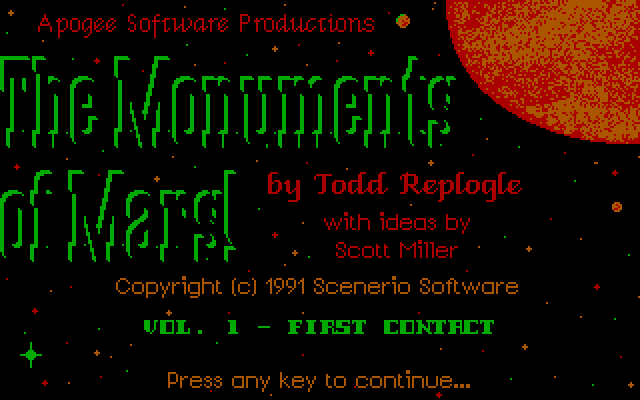
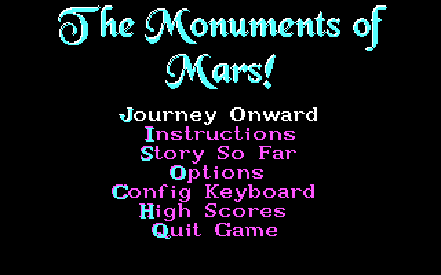
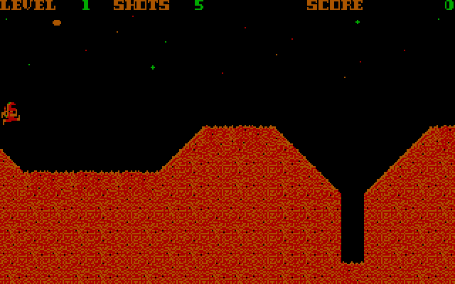
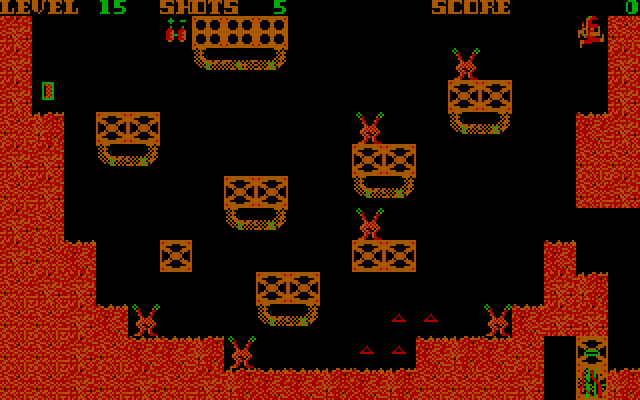
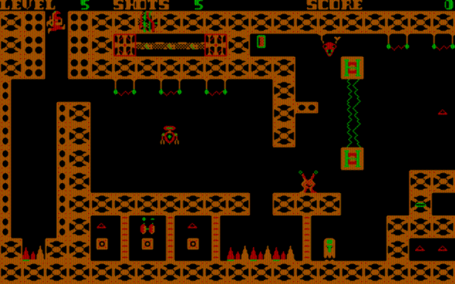

# Monuments of Mars port

A personal learning project: reverse engineering **Monuments of Mars** (Todd Replogle / Apogee,
1990-91, re-released as freeware in 2009; DOS, Turbo C, CGA) with Ghidra, then porting it to
run natively on modern systems in C11 and SDL2.

| | |
|:---:|:---:|
|  |  |
| The title screen | The main menu |
|  |  |
| Volume 1, level 1: the surface | Volume 2, level 15 |


*Volume 1, level 5, with the port's CRT filter*

## Layout

| Path        | Contents                                                        |
|-------------|-----------------------------------------------------------------|
| `src/`      | The port: C11 + SDL2                                            |
| `game/`     | Original game files (not committed, copy them in yourself)      |
| `unpacked/` | Decompressed EXEs produced by `tools/unlzexe.py` (not committed) |
| `tools/`    | Python helpers: unpacker, Ghidra dump/rename/annotate, graphics extractor |
| `analysis/` | Ghidra function names (`MARS1.names.txt`)                       |
| `docs/`     | Reverse engineering notes (`notes.md`) and the port's progress (`implementation-progress.md`) |

## The port

The port contains no game assets. At startup it reads everything from your own `MARSn.EXE`
(packed or unpacked) and the files beside it: the level maps, terminal actions, font and menu
screens from the EXE, the tiles from `MARSn.IGS` and the pictures from `MARSn.CF1` / `.CF2`.
The game logic is reimplemented in C from the original's machine code, routine by routine,
keeping the CGA's own memory layout so the blitters and collision tests could be ported
unchanged.

**The whole game is there**, all four volumes: every level, enemy, switch, terminal and sound
effect, the title screen and its Genus PCX transitions, the menus, story and instructions, the
high scores, saved games, the ending and the cheats, compatible with the original's `.HS`,
`.KBD`, `.SPD`, `.SV1` and `.SV2` files. The only differences:

- **Punctuation** uses the port's own 8x8 font, standing in for the IBM BIOS font, which can't
  be shipped. Letters and digits are drawn in the game's own font.
- **Quitting** shows the ordering info as the original does, but not its final text-mode
  shareware notice; the window just closes. A missing `.CF1` / `.CF2` gives an error box rather
  than the text-mode order form.
- **After level 20** the game ends straight away. The original first draws "LEVEL 21" over a
  level built from whatever bytes follow the level table.
- **Message screens** (the rescue message, the stone face, the ending) wait for a key to be
  pressed. The original's also ended on a key let go, so a key held as one came up closed it.
- **Esc** in a game opens the port's pause menu instead of asking QUIT (Y/N); Q still asks.
- **Ordering Info.** on the main menu is replaced by **Options** (lettered into the menu
  picture from its own letters).
- **Config Keyboard** (C on the main menu) is replaced by a **Controls** screen, where every
  game action gets two keys and two controller buttons of your choice (see below). A `.KBD`
  setup letter still gives the walk, jump and fire keys until you change them there.

Port extras: a pause menu and an Options screen, rebindable keys, game controller support,
three presets
(including **modern** physics at 120 steps a second), smooth movement, a CRT filter, full
screen and screenshots (see below).

The port reads `MARSn.HS`, `MARSn.KBD`, `MARSn.SPD`, `MARSn.SV1` and `MARSn.SV2` from the
folder the EXE is in, and **writes** them there as the original does: a new high score, the
speed check and the saved games (S in game). The controls are saved in `mars.ini` instead.

### Getting the game

The port needs the original game files, which Apogee released as freeware in 2009. They come
as `marsfree.zip` (201 KB, all four volumes) from either of these:

- [DOS Games Archive: Monuments of Mars](https://www.dosgamesarchive.com/download/monuments-of-mars)
  (the game's page, which can also run it in the browser), or its
  [direct download](https://www.dosgamesarchive.com/file/monuments-of-mars/marsfree)
- [Dukeworld: Apogee freeware archive](https://dukeworld.com/2001-current/apogee%20freeware/)
  (a folder of Apogee's freeware releases; pick `marsfree.zip`)

Unzip it next to `mars.exe` (for a release download) or into `game/` (when building from
source). The port needs `MARSn.EXE`, `MARSn.IGS`, `MARSn.CF1` and `MARSn.CF2` for each volume
you play; the other files are created as you play.

### Build (Windows, MSYS2 mingw64)

Needs the MSYS2 packages `mingw-w64-x86_64-gcc`, `-cmake`, `-ninja` and `-SDL2`. From a shell
with `C:\msys64\mingw64\bin` on `PATH`:

```
cmake -S . -B build -G Ninja -DCMAKE_BUILD_TYPE=Release
cmake --build build
```

That produces `build/mars.exe` with `SDL2.dll` copied next to it. On Linux/macOS the same
commands should work with SDL2 installed through your package manager (not tried yet).

### Run

```
build/mars.exe game/MARS1.EXE
```

Run `mars.exe game/MARS2.EXE` (and so on) for the other volumes. Without an EXE on the command
line, the port looks for `MARS1.EXE` in the current folder, then next to `mars.exe`.

With a release download, double-click `mars.exe` in the folder with the game files to play
volume 1, or run `mars.exe MARS2.EXE` (and so on) for the others. Dropping a `MARSn.EXE` onto
`mars.exe` works too. The game starts full screen; F11 or
Alt+Enter switches to a window, and `--window` starts in one.

Menu keys as in the original: J (or Enter) to journey onward, I instructions, S story so far,
O options, C controls, H high scores, Q quit. The port adds a highlight you move with
the arrow keys, the d-pad or the stick, and choose with Enter, Space or A.

Game keys (the defaults: the original's, with its keyboard setup D; C in the main menu changes
them):

| Key | Action |
|-----|--------|
| Left / Right, or Alt / Ctrl | walk |
| Space | jump |
| Left Shift | fire |
| Enter | use a switch, lever or terminal you're standing at |
| S / R | save / restore |
| F1 | sound on/off |
| F5 | pause |
| F6 | give up (lose a life and restart the level) |
| Q, then Y | quit to the main menu |
| Caps Lock on + PgDn / `` ` `` | cheat: next / previous level |
| Caps Lock on + `>` (main menu) | cheat: start with 20 shots |

Game controllers stand in for the keyboard (the original had no joystick support). Most
current pads (Xbox, PlayStation, Switch Pro, 8BitDo and others) are recognised automatically
and can be plugged in at any time; for anything else, put a
[`gamecontrollerdb.txt`](https://github.com/mdqinc/SDL_GameControllerDB) next to `mars.exe`.
Button names are Xbox ones; the in-game buttons are the defaults, which the Controls screen
changes (LT, RT and the stick clicks can be bound too):

| Control | In game | Menus and text screens | Y/N questions |
|---------|---------|------------------------|---------------|
| Left stick / d-pad | walk | up / down choose (main menu) | |
| A | jump | Enter | Y |
| X | fire | | |
| B or Y | use (Enter) | B: Esc | B: N |
| Start | pause menu | Enter | Y |
| Back / View | quit (Q) | Esc | N |
| LB / RB | save / restore | | |

The high score name and the cheats need the keyboard.

**Controls** (C in the main menu) shows every game action (walk left / right, jump, fire, use,
the pause menu, save, restore, quit, pause, sound, give up) with two keyboard keys and two
controller buttons. Move with the arrows, the d-pad or the stick; Enter or A, then press the
new key or button (Esc or Start cancels); Del or X clears one; Esc or B leaves, saving them in
`mars.ini`'s `[keys]` and `[pad]` sections. A key or button can only do one thing, so binding
it takes it from wherever it was. Esc and Start always open the pause menu and the left stick
always walks. While you play, a key bound to nothing that the game itself would read as an
action (Space once jump is elsewhere, say) does nothing; the menus, the Y/N questions and the
pause menu still take the usual keys.

Port keys:

| Key | Action |
|-----|--------|
| Esc | pause menu: Continue, Options, Quit to Menu, Quit Game |
| F4 | smooth movement on/off (`display.smooth`, classic physics only) |
| Alt+C | CRT filter on/off (`display.crt`) |
| F11 or Alt+Enter | full screen on/off |
| F12 | save a screenshot, `shotNNN.png`, in the current folder |

### Settings

The port has three presets:

- **classic** (the default): the original game exactly, quirks and all.
- **enhanced**: the original's rules and timing, with smooth movement and quick taps on.
- **modern**: the game rewritten to run at 120 steps a second.

Its settings:

- **Modern physics** (`game.physics = modern`): the original moves things 4 pixels across at
  a time, 18 times a second. Modern moves everything a pixel at a time at 120 steps a second
  at the same average speeds, and draws at your monitor's refresh rate. The levels and rules
  are the same, and the original's collision points are kept, now tested at every pixel. Sound
  effects no longer stop the game. A few of the original's quirks are fixed along the way:
  - Landings are exact (the original sinks up to 3 rows into the floor and climbs back out).
  - Pickups don't block you, and a jump carries on through them instead of stopping on one.
  - Enemies and drips kill only when their pixels touch yours, not on the original's boxes,
    which reached well past the pictures (a robot hovering 10 px above your head killed you).
  - A jump needs a fresh press of the jump key, and so does a shot. A press just before
    landing still jumps on landing.
  - Enter acts once per press.
  - Only you can push a boulder (in the original a robot could push one too), and not into
    an enemy on its other side.
  - You stand on the moving platforms and ride them exactly.

  `docs/notes.md` ("Modern physics") lists every difference and why.
- **Smooth movement** (`display.smooth`): with classic physics, moving things glide between
  the game's steps at your monitor's refresh rate. Only the picture changes; the game plays
  exactly as without it. F4 switches it while playing.
- **Quick taps** (`input.quick_taps`): a key or button tapped and let go between two of the
  game's frames still counts. The original only sees what is held as a frame starts, so a
  quick tap of jump or Enter could be missed.
- **CRT filter** (`display.crt`, off in every preset): the CRT look of RetroArch's
  `2xsal-level2-crt` shader preset. The picture is doubled with 2xSaL's smoothed edges, then
  scaled to the window under a shadow mask. Alt+C switches it.
- **Full screen** (`display.fullscreen`, on in every preset).

Choose a preset with `--classic`, `--enhanced` or `--modern`, or in a `mars.ini` file next to
`mars.exe`, which can also change single settings:

```ini
[game]
preset = classic      ; or enhanced, or modern
physics = classic     ; or modern (120 steps a second)

[display]
smooth = off          ; things glide between the game's steps (on in enhanced). F4 switches
crt = off             ; the CRT filter. Alt+C switches
fullscreen = on       ; F11 or Alt+Enter switches

[input]
quick_taps = off      ; a tap between two frames still counts (on in enhanced and modern)

[keys]                ; the Controls screen's: two keys per action, - for none
jump = SPACE, Z
fire = LSHIFT, -

[pad]
jump = A, -
fire = X, RT
```

`mars --print-settings > mars.ini` writes a complete file with every setting explained. The
command line overrides the file: `--set display.crt=on`, for example. The Options screen (in
the main menu and the pause menu) switches physics, smooth movement, the CRT filter, full
screen and quick taps at once, and saves the ones you changed into `mars.ini`, keeping
everything else in the file as it was. F4, Alt+C and F11 change the current run only.

### Command line

```
mars [MARSn.EXE] [options]
```

| Option | What it does |
|--------|--------------|
| `--classic` / `--enhanced` / `--modern` | choose the preset (overrides `mars.ini`) |
| `--set section.key=value` | change one setting, e.g. `--set game.physics=modern` (can be repeated) |
| `--config FILE` | read settings from FILE instead of `mars.ini` next to `mars.exe` |
| `--print-settings` | print the current settings as a `mars.ini` and exit |
| `--crt` | start with the CRT filter on |
| `--window` | start in a window |
| `--palette 0\|1` | force CGA palette 0 or 1 (the game itself uses 0 for play and 1 for the menu) |
| `--bright` | use the high intensity palette |
| `--level N` | skip the title, play level N first, then go on to the menu |

For testing and development (these run without a window, and read `mars.ini` only when
`--config` names it):

| Option | What it does |
|--------|--------------|
| `--screenshot out.png` | write the title screen, or with `--level` that level's first frame, to a PNG and exit |
| `--script "..."` | play a level with scripted keys, then print the level, position, shots, score and deaths |
| `--show SCREEN` | run one menu screen (`title`, `menu`, `story`, `instructions`, `ordering`, `keys`, `hiscores`, `notice`), writing `<out>-N.png` (from `--screenshot`) at every wait for a key |

A script is a list of tokens, each a number of frames followed by the keys held for them:
`l r j f e` (left, right, jump, fire, Enter), or `S` / `R` (save / restore, answering Y). A
number alone waits. For example, `--level 2 --script "30 10r 12 1rf 40"`. With
`--screenshot`, the last frame is written too.

## Reverse engineering workflow

The shipped `MARSn.EXE` files are compressed with LZEXE 0.91, so Ghidra only sees the
decompression stub. Unpack them first:

```
python tools/unlzexe.py game/MARS1.EXE unpacked/MARS1.EXE
```

Then import `unpacked/MARS1.EXE` into Ghidra (format: Old-style DOS Executable (MZ)), run
auto-analysis, and apply the known names with
`python tools/ghidra_rename.py analysis/MARS1.names.txt` (needs GhidraMCP running).
`tools/ghidra_dump.py` dumps the whole disassembly, and `tools/annotate.py` prints one
function readably, for the ones the decompiler can't handle (like `main`). The game was built
with Turbo C in the huge memory model; `docs/notes.md` has the segment map, every decoded
routine and table, and the GhidraMCP quirks to watch for.

## License

The port's source code and tools are released under the MIT License (see `LICENSE`), except
`src/crt.c`, which translates two GPL shaders from RetroArch's collection (`2xsal-level2.slang`
by guest(r), and `dotmask.slang` by cgwg, Timothy Lottes and torridgristle) and is under the GNU
General Public License, version 2 or later (see `LICENSE-GPL-2.0.txt`). A build of the port
includes it, so the program as a whole is distributed under the GPL.

That covers this repository only: Monuments of Mars itself is (c) 1990-91 Scenerio Software
and Apogee Software, distributed as freeware, and none of its files are included here.
